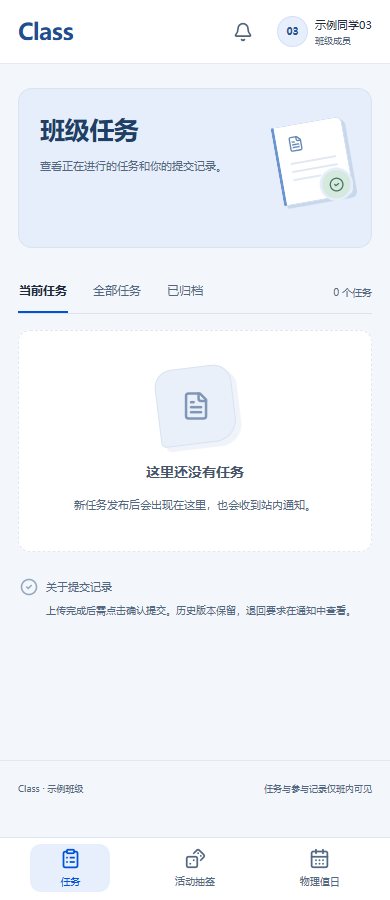

# Class · 班级事务空间

为日常班级材料收集与协作制作的 Web 工具。功能包括任务发布、材料上传与审核、原件批量导出、抽签、值日与站内通知。

技术栈：React / TypeScript / Vite + FastAPI / SQLAlchemy，支持独立 SQLite 开发环境与 MySQL 部署。



## 为什么做

班级事务中，群聊收文件容易出现漏交、补交版本混乱、人工统计与反复催交。Class 把任务、提交状态、文件版本和通知放到一个持续使用的工作空间，也加入抽签和值日等日常功能。本人完成需求整理、系统开发、测试和部署维护，开发过程中使用 AI 辅助。

## 公开版边界

这是脱敏后的源码展示副本，具有全新 Git 历史，不是正式班级站点的数据库或部署备份。姓名、学号与班级标识均已替换为合成示例；不公开任何正式账号、密码、管理员密钥、真实名册、提交材料或班内业务记录。原系统继续运行，未因公开发布修改或重启。

`examples/roster.example.json` 仅供本地初始化，全部为虚构身份。业务规则保留37人示例模板，适配其他人数或值日规则需调整`backend/domain.py`及初始化校验；不是通用SaaS产品。

## 本地运行（PowerShell）

需要 Python 3.12 和 Node.js。仅在全新本地环境执行，不连接正式数据库。

```powershell
python -m venv .venv
.venv/Scripts/python -m pip install -r requirements.lock
$env:CLASS_DATA_DIR = "runtime"
$env:CLASS_ORIGINS = "http://localhost:5173"
# 在当前终端自行设置两个不同的私密值，不要提交到 Git。
$env:CLASS_ADMIN_KEY = Read-Host "设置本地管理员密钥（至少32字符）"
$env:CLASS_STUDENT_PASSWORD = Read-Host "设置本地示例学生口令（至少12字符）"
.venv/Scripts/python -m backend.seed
.venv/Scripts/python -m uvicorn backend.main:app --host 127.0.0.1 --port 18082
```

另开终端：
```powershell
cd frontend
npm ci
npm run dev
```

打开 http://localhost:5173 。本地身份来自合成示例，口令由部署者自行配置。已有数据库初始化会被拒绝，避免覆盖账号。

## 验证

```powershell
.venv/Scripts/python -m pytest tests -q
cd frontend
npm test
npm run build
```

测试只使用独立临时库和合成数据；测试夹具不是正式登录凭据。当前结果与范围见[验证记录](docs/VALIDATION.md)。本次未重做真MySQL、线上备份恢复或真实手机验收，不沿用历史数字作为本轮结果。

## 已知边界

原项目2026-11-05审查仍记录磁盘空间不足时上传临时文件/并发导出的预算与清理缺口，以及异机备份通知返回码检查缺口。本次公开副本未擅自宣称这些问题已修复。当前仓库仅保留应用源码与隔离测试，不附带正式部署、SSH或备份工具。生产部署需要独立评估配额、访问控制、备份和恢复流程。

项目用于技术展示；尚未单独授予覆盖全部源码的统一开源许可证。第三方组件遵循各自许可证。
